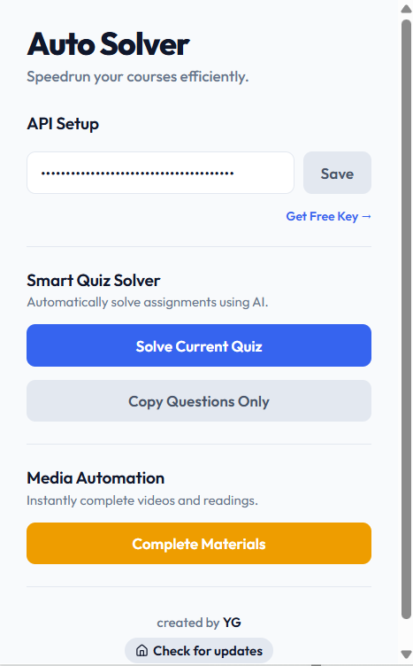

> [!CAUTION]
> ### ⚠️ Disclaimer: For Educational Purposes Only
> This extension was created strictly for **educational and learning purposes** to explore browser extension development, DOM manipulation, and API interception.
>
> * **No Liability:** The creator of this extension is not responsible for any consequences that may arise from using this tool.
> * **Academic Integrity:** Coursera has strict policies regarding academic integrity. Using this tool to automatically complete courses or solve quizzes may violate Coursera's Terms of Service and Honor Code.
>
> By using this open-source software, you agree that you are taking full responsibility for your own actions.

# Coursera Assignment Solver 🎓

  
  
<em>Speedrun your courses smoothly</em>

A sleek, lightweight Chrome Extension (Manifest V3) that helps you navigate and automate your Coursera courses with ease.

## ✨ Features

* **⚡ Media Auto-Completer:** Instantly mark all videos, readings, and supplements as complete in the background. No API key or setup required.
* **📋 Question Extractor:** Neatly extracts all quiz and assignment questions from the page into a clean, copyable JSON format. No API key needed.
* **🤖 Smart Quiz Solver:** Automatically solves multiple-choice, checkbox, text-input, and essay questions using your own Google Gemini API key.

## 🚀 How to Use

### 1. Install the Extension
1. Clone or download this repository to your local machine.
2. Open Google Chrome and navigate to `chrome://extensions/`.
3. Enable **Developer mode** (toggle in the top-right corner).
4. Click **Load unpacked** and select the folder containing this extension's files.

### 2. Configure and Run
1. Navigate to any Coursera course page inside the `/learn/` path.
2. Click the **Coursera Assignment Solver** icon in your Chrome toolbar.
3. **Complete materials:** click **Complete Materials** to mark all videos/readings complete, or **Copy Questions Only** to extract quiz questions.
4. **Solve quizzes:** get a free Google Gemini API key from [Google AI Studio](https://ai.google.dev/aistudio), paste it into the popup, click **Save**, then click **Solve Current Quiz**.

## 🔒 Privacy & Security

* **Coursera requests:** all course-completion requests go only to `https://www.coursera.org`, using your existing browser session (CSRF token + user/course ID).
* **Gemini requests:** only the **questions you choose to solve** are sent to the Google Gemini API (`generativelanguage.googleapis.com`) using **your own API key**, which is stored locally via `chrome.storage.local`. Nothing is sent anywhere else.
* **Permissions:** `activeTab`, `scripting`, `storage`, plus a host permission scoped to Coursera only.
* No analytics, no tracking, no third-party servers.

## 🆕 Changelog

**v1.1.0**
- ⚙️ **Configurable Gemini model:** pick any model in the popup (default remains `gemini-3-flash-preview`).
- 🔧 **Fixed XHR token capture:** the interceptor now records headers set via `setRequestHeader`, so CSRF tokens are captured on XHR requests too (previously only `fetch` was captured reliably).
- 🛎️ **No more intrusive popups:** replaced browser `alert()` dialogs with the in-page status banner.

## 🗂️ Project Structure

| File | Purpose |
|---|---|
| `manifest.json` | Manifest V3 definition |
| `content.js` | Scrapes questions, applies answers, drives the completion loop |
| `intercept.js` | Runs in the page's `MAIN` world to capture CSRF token / IDs from Coursera's own requests |
| `background.js` | Service worker that talks to the Gemini API |
| `popup.html` / `popup.js` | Extension popup UI |
| `icons/` | Extension icons |

## ⚖️ Disclaimer

This tool is created for **educational and research purposes** to demonstrate browser automation capabilities. Use it responsibly and in accordance with [Coursera's Terms of Service](https://www.coursera.org/about/terms). The author is not responsible for any misuse.

## 🙏 Credits

Based on the original **Coursera Auto Solver** by [Youssef Ghafir (YG)](https://github.com/Youssef-Ghafir), reused and republished with the author's permission. See the original project [here](https://github.com/Youssef-Ghafir/coursera-assignment-solver).

## 📄 License

Released under the [MIT License](LICENSE).
